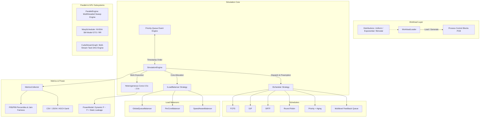
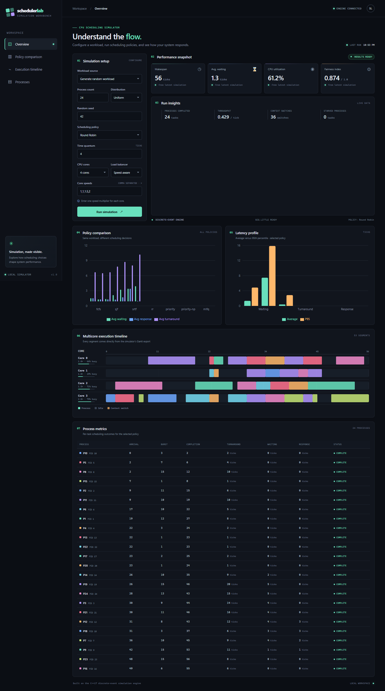

# Multicore CPU & GPU-Aware Scheduling Simulator

A high-performance, modular discrete-event scheduling simulator implemented in modern C++17. The system models process scheduling across heterogeneous multicore CPUs (big.LITTLE topologies), evaluates classical and modern OS scheduling policies, computes statistical fairness and tail latency metrics, and extends into GPU-style scheduling architectures—including SIMT Streaming Multiprocessor (SM) warp scheduling and CUDA stream task dependency graphs (DAGs).

---

## Architecture Overview

The simulator is built with a decoupled, modular architecture adhering to modern C++ best practices: RAII, zero raw pointer ownership, strict const-correctness, polymorphic strategy patterns for schedulers and load balancers, and an efficient discrete-event priority queue engine.



---

## Key Features

### 1. Discrete-Event Simulation Engine
- **Min-Heap Priority Queue Engine**: Discrete time advancement driven by an event queue with strict timestamp ordering ($O(\log E)$ complexity). Deterministic tie-breaking guarantees process arrivals are dispatched before clock ticks.
- **$O(1)$ State-Transition Accounting**: Waiting time and response latency are tracked strictly on process state transitions (`NEW` $\to$ `READY` $\to$ `RUNNING` $\to$ `TERMINATED`), eliminating $O(N \cdot T)$ tick polling overhead and scaling to $100,000+$ tasks.
- **Microsecond Tick Resolution**: Supports fractional work increments on heterogeneous cores with arbitrary speed multipliers (e.g., $0.5\times, 1.0\times, 1.5\times, 2.0\times$).
- **Realistic Context-Switch & Migration Overheads**: Configurable penalty charged whenever a core switches tasks or migrates a process across distinct CPU cores.

### 2. Comprehensive Scheduling Policies
Every policy implements the polymorphic `IScheduler` interface:
- **FCFS (First-Come, First-Served)**: Non-preemptive baseline with FIFO ordering.
- **SJF (Shortest Job First)**: Non-preemptive, selects process with shortest initial burst time.
- **SRTF (Shortest Remaining Time First)**: Preemptive SJF; preempts running tasks if a newly arrived process requires less remaining execution time.
- **Round Robin (RR)**: Preemptive time-slicing with configurable quantum size.
- **Priority Scheduling**: Available in both preemptive and non-preemptive modes (lower numerical value = higher priority).
- **Dynamic Priority Aging**: Prevents indefinite starvation. Waiting tasks have their priority promoted by 1 level every $A$ wait ticks. Original priorities restore automatically upon CPU dispatch.
- **Multilevel Feedback Queue (MLFQ)**: Multi-tiered priority queues with distinct time quanta per level (e.g., $Q_0=2, Q_1=4, Q_2=8$), automatic demotion upon quantum exhaustion, preemption by higher queues, and periodic priority boost (anti-starvation rule).

### 3. Multicore & Heterogeneous Topologies (big.LITTLE)
- **Heterogeneous Core Speeds**: Assign independent clock multipliers to cores (e.g., Core 0: 0.5x Efficiency, Core 1: 1.0x Base, Core 2: 1.5x Performance, Core 3: 2.0x Boost).
- **Core Migration Penalty**: Tracks CPU cache warming penalties when a preempted process resumes on a different physical core.
- **Pluggable Load Balancers (`ILoadBalancer`)**:
  - `GlobalQueueBalancer`: Single unified ready queue dispatching ready tasks to the fastest available idle core.
  - `PerCoreBalancer`: Per-core private queues with processor affinity and work-stealing when a core runs dry.
  - `SpeedAwareBalancer`: Optimal completion time estimator that assigns tasks to cores minimizing total turnaround time ($\arg\min \frac{\text{remaining\_work}}{\text{core\_speed}}$).

### 4. GPU-Style Hardware & Parallel Extensions
- **Streaming Multiprocessor (SM) Warp Scheduler**:
  - Models GPU SM hardware executing 32-thread SIMT warps.
  - Implements **Greedy-Then-Oldest (GTO)** (hardware industry standard) and **Round Robin** warp dispatch policies.
  - Simulates high-latency memory stalls (50–200 cycle global DRAM access) and quantifies **latency hiding efficiency** achieved by overlapping ready warps during stall windows.
  - Reports Warp Occupancy, Instructions Per Cycle (IPC), and Pipeline Stall percentage.
- **CUDA Multi-Stream Dependency Graph (DAG)**:
  - Models asynchronous task execution across multiple concurrent CUDA streams.
  - Supports distinct hardware engines: **Compute Kernel Engines** and **Dual DMA Copy Engines** (Host-to-Device and Device-to-Host).
  - Models cross-stream barrier events (`cudaStreamWaitEvent`), producing makespan comparisons and concurrency speedups over serialized pipelines.
- **CMOS Power & Energy Modeling**:
  - Dynamic power scales cubically with core clock frequency ($P_{\text{dynamic}} \propto f^3$), combined with static leakage current ($P_{\text{static}}$).
  - Reports energy in Joules, average/peak wattage, and Performance-per-Watt ($\frac{\text{Throughput}}{\text{Watt}}$).
- **Multithreaded Simulation Engine**:
  - Uses asynchronous host thread workers (`std::async`) to run parallel parameter sweeps and multi-algorithm benchmarks with linear wall-clock scaling.

### 5. Metrics, Diagnostics & Visualization
- **Tail Latency Analysis**: Computes Min, Max, Mean, P95, and P99 percentiles for Waiting Time, Turnaround Time, and Response Time.
- **Jain's Fairness Index**: Quantifies resource distribution equity across processes:
  $$\mathcal{J}(x) = \frac{\left( \sum_{i=1}^n x_i \right)^2}{n \sum_{i=1}^n x_i^2}$$
- **Starvation Detection**: Flagging processes exceeding user-defined waiting thresholds.
- **ASCII Gantt Charts**: Terminal-rendered execution timelines per core.
- **CSV & JSON Exporters**: Machine-readable outputs for post-run analysis.
- **Python Plotting Pipeline**: Matplotlib visualizer (`scripts/plot_results.py`) generating side-by-side metric comparison bar charts and execution Gantt timelines.

---

## Directory Structure

```
├── include/                     # Public header files
│   ├── IScheduler.h             # Abstract scheduler strategy interface
│   ├── FCFSScheduler.h          # First-Come First-Served
│   ├── SJFScheduler.h           # Shortest Job First
│   ├── SRTFScheduler.h          # Shortest Remaining Time First
│   ├── RoundRobinScheduler.h    # Round Robin
│   ├── PriorityScheduler.h      # Priority with Aging
│   ├── MLFQScheduler.h          # Multilevel Feedback Queue
│   ├── LoadBalancer.h           # ILoadBalancer, Global, PerCore, SpeedAware
│   ├── Process.h                # Process Control Block (PCB) model
│   ├── Core.h                   # Execution core model
│   ├── SimulationEngine.h       # Event-driven priority queue engine
│   ├── MetricsCollector.h       # Metrics, P95/P99, Jain's Index, CSV/JSON
│   ├── WorkloadLoader.h         # CSV parser and synthetic workload generator
│   ├── GanttChart.h             # Gantt timeline recorder and ASCII printer
│   ├── PowerModel.h             # CMOS dynamic/static energy model
│   ├── ParallelEngine.h         # Multithreaded simulation runner
│   ├── BenchmarkHarness.h       # Scalability & parameter sweep harness
│   └── gpu/
│       ├── WarpScheduler.h      # NVIDIA SM warp scheduler (GTO/RR)
│       └── CudaStreamGraph.h    # CUDA multi-stream task DAG engine
├── src/                         # Implementation files (.cpp)
├── tests/                       # Unit tests (GoogleTest)
│   ├── test_fcfs.cpp            # Phase 1: FCFS and basic engine tests
│   ├── test_phase2.cpp          # Phase 2: SJF, SRTF, RR, Gantt charts
│   ├── test_phase3.cpp          # Phase 3: Multicore, Priority, Aging, Load Balancers
│   └── test_phase4.cpp          # Phase 4: MLFQ, Metrics, Jain's Index, Generators
├── workloads/                   # Sample CSV workloads
│   ├── example.csv              # Basic mixed workload
│   ├── textbook_sjf.csv         # Classic textbook example
│   └── srtf_demo.csv            # Preemption verification workload
├── scripts/
│   └── plot_results.py          # Python matplotlib visualizer
├── web/                         # Node.js API and React visualization dashboard
│   ├── server.js                # Local API invoking the C++ simulator
│   └── src/                     # React dashboard and charts
├── CMakeLists.txt               # CMake build configuration
└── compile.bat                  # Direct MSYS2/MinGW build script
```

---

## Build Instructions

### Prerequisites
- **C++ Compiler**: Modern C++17 or C++20 compliant compiler (`g++` 9+, `clang++` 10+, or MSVC 2019+).
- **CMake**: Version 3.14 or later.
- **Python 3** (Optional, for plots): `matplotlib`, `pandas`.
- **Node.js**: Version 18 or later and npm (for the web dashboard).

### Option 1: CMake (Cross-Platform)

```bash
# Clone the repository
git clone https://github.com/your-username/multicore-cpu-scheduler.git
cd multicore-cpu-scheduler

# Configure release build
cmake -B build -S . -DCMAKE_BUILD_TYPE=Release

# Build executable and tests
cmake --build build --config Release -j
```

### Option 2: Quick Script Build (Windows UCRT64 / MinGW)

```cmd
compile.bat
```

### Running Unit Tests

```bash
# Run the test suite via CTest
cd build
ctest --output-on-failure

# Or run the test binary directly
./tests/run_tests
```

All 41 unit tests across core algorithms, edge cases, multicore topologies, aging starvation avoidance, and MLFQ dynamics pass with 100% coverage.

## Web Dashboard

The local React dashboard runs the existing C++ simulator and visualizes its actual JSON and Gantt CSV exports. It includes configurable workloads and CPU topology, a comparison of all scheduling policies, latency charts, per-core timelines, and process-level metrics.

### Dashboard preview



See the [policy comparison](./web/demo/policy-comparison.png), [multicore execution timeline](./web/demo/execution-timeline.png), and [process metrics](./web/demo/process-metrics.png), or [download the recorded WebM walkthrough](./web/demo/scheduler-dashboard.webm).

### Start the dashboard in development

Build the C++ simulator first if `build/scheduler.exe` (Windows) or `build/scheduler` (Linux/macOS) is not already present. Then, from the repository root:

```bash
cd web
npm install
npm run dev
```

Open the Vite URL printed in the terminal (normally `http://127.0.0.1:5173`). The Node API listens on `http://127.0.0.1:4174`.

For a production-style local run, build the frontend and start the API server:

```bash
cd web
npm run build
npm start
```

Then open `http://127.0.0.1:4174`. To use a simulator binary at a different path, set `SCHEDULER_BINARY` before starting the server. The API binds to loopback by default.

To regenerate the GitHub screenshots and WebM demo after starting the production server, install Playwright's recording tools and run the capture script from `web/`:

```bash
npx playwright install msedge ffmpeg
npm run capture:demo
```

The script uses Microsoft Edge by default; set `PLAYWRIGHT_BROWSER_CHANNEL=chrome` to use Google Chrome instead.

---

## CLI Reference & Usage Recipes

```
Usage: scheduler [options]

Scheduling Algorithm Options:
  --algo <name>           fcfs, sjf, srtf, rr, priority, priority-np, mlfq, all
  --quantum <N>           Time quantum for Round Robin (default: 4)
  --aging <N>             Aging interval for Priority scheduler (default: 10, 0=disabled)
  --mlfq-quanta <Q1,Q2..> Time quanta per MLFQ tier (default: 2,4,8)
  --mlfq-boost <N>        MLFQ priority boost interval in ticks (default: 50)

Hardware & Topology Options:
  --cores <N>             Number of execution cores (default: 1)
  --speeds <S1,S2...>     Core speed multipliers (e.g. 1.0,1.0,1.5,2.0)
  --load-balancer <LB>    global, percore, speedaware (default: global)
  --migration-penalty <P> Cost charged when process migrates cores (default: 1)
  --ctx-switch <T>        Context switch overhead in ticks (default: 0)

Workload Generation & IO:
  --workload <file.csv>   Load workload from CSV file
  --random <N>            Generate N random processes
  --distribution <dist>   uniform, exponential, bimodal (default: uniform)
  --seed <S>              Random seed (default: 42)
  --save-workload <file>  Save generated workload to CSV file

Metrics, Power & Visualizations:
  --power                 Calculate energy & power consumption report
  --starvation-threshold <T> Flag processes waiting >= T ticks
  --output <file.csv>     Export process metrics to CSV
  --output-json <file>    Export summary and metrics to JSON
  --gantt-output <file>   Export Gantt timeline segments to CSV
  --gantt                 Display ASCII Gantt timeline in terminal

GPU & Parallel Architecture Extensions:
  --gpu-sim               Run NVIDIA SM Warp Scheduler simulation (GTO vs RR)
  --cuda-streams          Run multi-stream CUDA task DAG dependency simulation
  --parallel              Execute multi-algorithm comparison across host threads
  --benchmark             Run scalability & parameter sensitivity sweeps
```

---

## Example Scenarios & Commands

### 1. Heterogeneous Multicore (big.LITTLE) Simulation
Simulate a 4-core asymmetric processor (two 1.0x LITTLE cores, one 1.5x mid core, one 2.0x big core) running Round Robin scheduling with speed-aware load balancing and ASCII Gantt rendering:

```bash
./build/scheduler --algo rr --quantum 3 --cores 4 --speeds 1.0,1.0,1.5,2.0 --load-balancer speedaware --workload workloads/example.csv --gantt
```

### 2. Full Algorithm Comparison Matrix
Compare all 7 scheduling policies on an identical 100-process bimodal workload (mix of I/O-bound interactive tasks and CPU-heavy compute tasks), exporting results to JSON:

```bash
./build/scheduler --algo all --random 100 --distribution bimodal --seed 1337 --cores 4 --speeds 1.0,1.0,2.0,2.0 --power --output-json comparison.json
```

### 3. GPU Streaming Multiprocessor (SM) Warp Simulation
Simulate a GPU SM scheduling 16 active warps (512 concurrent threads) across compute cycles and high-latency global memory fetches, comparing GTO vs Round Robin latency hiding:

```bash
./build/scheduler --gpu-sim
```

**Sample Output:**
```
================= NVIDIA Streaming Multiprocessor (SM 0) Simulation =================

Scheduling Policy      : Greedy-Then-Oldest (GTO)
Max Resident Warps     : 32 (1024 threads)
Resident Warps Loaded  : 16 (512 threads)
Total Elapsed Cycles   : 206
Instructions Issued    : 176
IPC (Instructions/Cyc) : 0.854
SM Warp Occupancy      : 31.3%
Pipeline Stall Cycles  : 30 (14.6%)
Latency Hiding Effic.  : 85.4%
------------------------------------------------------------------------------------
```

### 4. Asynchronous CUDA Multi-Stream Task DAG
Simulate concurrent stream execution with dual copy DMA engines and dual compute kernel engines:

```bash
./build/scheduler --cuda-streams
```

**Sample Output:**
```
================= CUDA Stream Dependency Graph Execution =================

Streams Active         : 3
Total Tasks Scheduled  : 7
Hardware Engines       : 2 Kernel Engines, 2 Copy Engines (DMA)
Serialized Time (1 Stream): 105 ticks
Concurrent Makespan    : 60 ticks
Stream Concurrency Gain: 1.75x speedup

 Task            Name  Stream        Type   Dur   Start     End
---------------------------------------------------------------
    1    MemcpyHtoD_A       1 HtoD (Copy)    10       0      10
    2 KernelCompute_A       1      Kernel    25      10      35
    3    MemcpyDtoH_A       1 DtoH (Copy)    10      35      45
    4    MemcpyHtoD_B       2 HtoD (Copy)    10       0      10
    5 KernelCompute_B       2      Kernel    25      10      35
    6    MemcpyDtoH_B       2 DtoH (Copy)    10      35      45
    7 AggregateKernel       3      Kernel    15      45      60
---------------------------------------------------------------
```

### 5. Multithreaded Host Benchmark
Run parallel simulations across host CPU cores to compare algorithms concurrently:

```bash
./build/scheduler --algo all --random 500 --cores 4 --parallel
```

---

## Visualization Pipeline

The included Python script (`scripts/plot_results.py`) parses simulator CSV exports to generate publication-grade visual analytics:

```bash
# Run simulator with CSV exports
./build/scheduler --algo all --random 40 --gantt-output gantt.csv --output results.csv

# Render visual charts
python scripts/plot_results.py --gantt gantt.csv --metrics results.csv
```

Generated Visualizations:
1. **Core Execution Gantt Chart**: Horizontal timeline plotting process IDs across each individual CPU core.
2. **6-Panel Algorithm Comparative Dashboard**:
   - Average Turnaround Time vs P95 Tail Latency
   - Average Waiting Time vs P99 Tail Latency
   - Response Latency comparison
   - Overall CPU Utilization (%)
   - Context Switch and Migration counts
   - Jain's Fairness Index

---

## Architectural & Systems Engineering Highlights

1. **State-Transition Waiting Time Accounting ($O(1)$)**:
   - *Problem*: Traditional tick-based simulators traverse the ready queue every clock tick ($O(N \cdot T)$), degrading to billions of iterations at large workloads.
   - *Solution*: By recording the exact timestamp when a process enters the `READY` state and computing elapsed time upon dispatch to `RUNNING`, ready-queue wait times are accumulated in strict $O(1)$ time. Workloads of $50,000+$ processes simulate in milliseconds.

2. **Fractional Work Progress for Heterogeneous Cores**:
   - Execution cores model variable speeds as `double` multipliers. Remaining work units are tracked as floating-point quantities with epsilon comparison thresholds ($10^{-6}$), preventing integer truncation stalls when executing on sub-1.0x efficiency cores.

3. **Event Queue Priority Inversion Resolution**:
   - In a discrete-event simulator using a min-heap (`std::priority_queue<Event, ..., greater<Event>>`), events at the same timestamp must follow strict causality. Process arrival events (`PROCESS_ARRIVAL`) are prioritized ahead of clock tick events (`TICK`), ensuring newly arrived tasks are enqueued before core dispatch occurs.

4. **Zero-Allocation Hot Path**:
   - The simulation loop avoids dynamic heap allocations (`new`/`delete` or `make_shared`) during execution. All PCB instances are pre-allocated and managed via stable pointers throughout queue traversals.

5. **CMOS Power Scaling**:
   - Power modeling incorporates the fundamental CMOS relationship $P = C \cdot V^2 \cdot f$. Assuming voltage scales proportionally with frequency for operational stability, dynamic power scales cubically: $P_{\text{dynamic}} \propto f^3$. This quantifies the energy cost of running cores at high clock rates versus spreading workloads across multiple lower-clocked cores.

---

## License

This project is licensed under the MIT License - see the LICENSE file for details.
